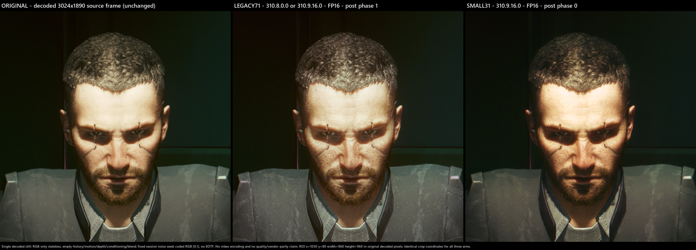
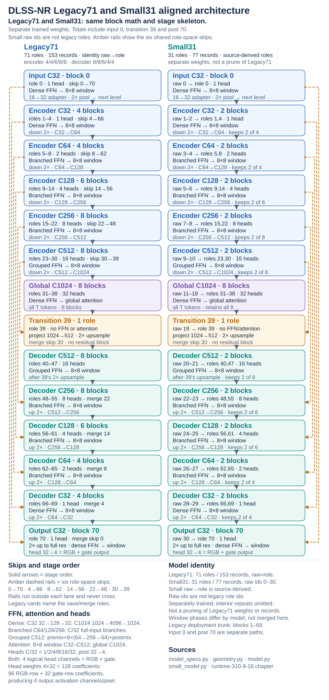
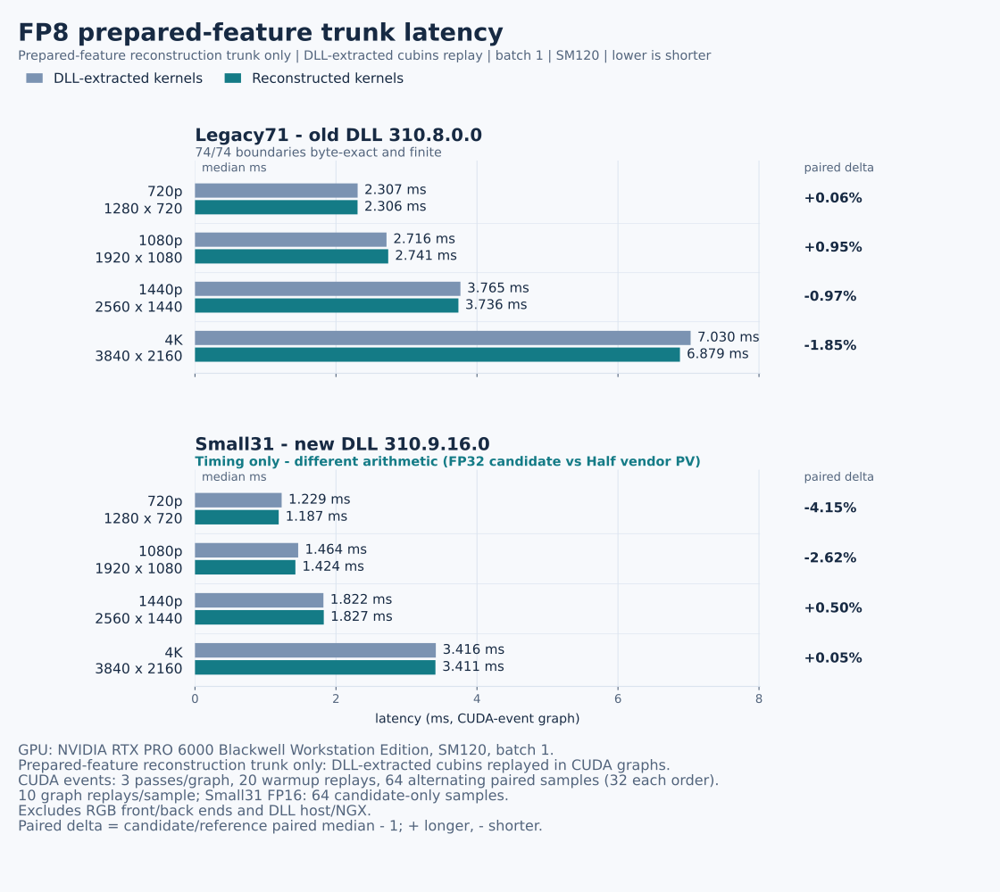
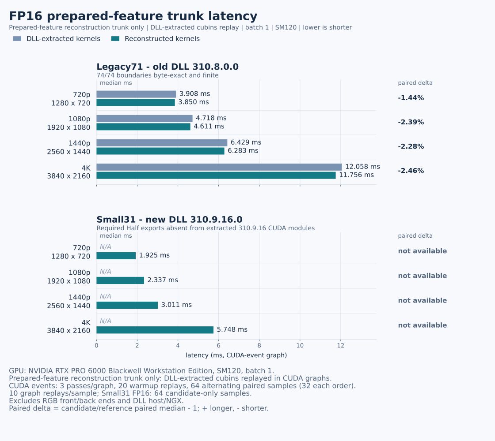
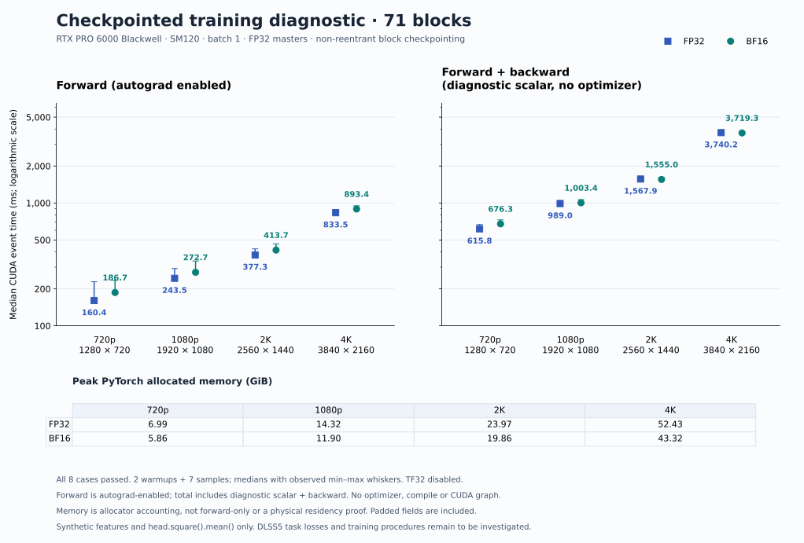

# DLSSNR-PyTorch

**[Documentation](https://dylanwaken.github.io/DLSS5-Pytorch/kernel-guide/)** · [Cyberpunk comparison](https://dylanwaken.github.io/DLSS5-Pytorch/kernel-guide/cyberpunk-comparison.html) · [310.9.16 / Small31 update](https://dylanwaken.github.io/DLSS5-Pytorch/kernel-guide/runtime-310-9-16.html) · [Network architecture](https://dylanwaken.github.io/DLSS5-Pytorch/kernel-guide/architecture.html) · [Kernel lessons](https://dylanwaken.github.io/DLSS5-Pytorch/kernel-guide/index.html#kernels) · [Glossary](https://dylanwaken.github.io/DLSS5-Pytorch/kernel-guide/glossary.html) · [Design process & experiments](https://dylanwaken.github.io/DLSS5-Pytorch/kernel-guide/measurement-method.html)

[](https://dylanwaken.github.io/DLSS5-Pytorch/kernel-guide/cyberpunk-comparison.html)

*Original downloaded pixels → Legacy71 reconstruction → Small31 reconstruction, FP16, RGB-only stateless research. Not an official DLL reference. Imagery © CD PROJEKT RED; unofficial comparison, not approved or endorsed by CD PROJEKT RED. [Comparison chapter](https://dylanwaken.github.io/DLSS5-Pytorch/kernel-guide/cyberpunk-comparison.html) · [FP16 overview video](https://dylanwaken.github.io/DLSS5-Pytorch/kernel-guide/media/cyberpunk-20261030/video-fp16-overview.mp4) · [FP8 overview video](https://dylanwaken.github.io/DLSS5-Pytorch/kernel-guide/media/cyberpunk-20261030/video-fp8-overview.mp4).*

Reconstructed DLSS-NR CUDA kernels for PyTorch, plus a differentiable network for training research. The project follows the recovered network and packed weights, with graph/layout work adapted from [OpenDLSS-NR](https://github.com/maanHimself/OpenDLSS-NR/tree/9d08f4184bbcb9d858e2fb7a7834ec0837a9d2f1).

## What works today

| Route | What you can use |
|---|---|
| **FP8 deployment** | Prepared-feature inference at arbitrary supported padded resolutions; builds for SM89+ (RTX 40 series and newer). |
| **FP16 deployment** | Complete CUDA/C++ trunk with runtime geometry and capacity-aware scheduling; builds for SM80+ (including RTX 30 series). |
| **FP32 / BF16 training** | The default 71-role graph and opt-in Small31 graph, ordinary autograd and optional activation checkpointing. |
| **RGB research pipeline** | Both models in FP16/FP8 on SM120, with native preprocess, prepared trunk and postprocess. RGB-only stateless mode; no renderer motion/depth/history integration. |

Deployment builds separate binaries per architecture, or one multi-architecture library. Native runtime measurements use an RTX PRO 6000 Blackwell (SM120). Earlier Ampere/Ada compilation and lower-target PTX checks covered the original kernel set; the added Small31 path has native acceptance on SM120. Physical RTX 30/40 hardware remains untested. Prepared-feature APIs and an RGB-only research pipeline are available; engine renderer integration is not included. C++ prepares arbitrary supported resolutions and uses ordered split launches for smaller GPU capacity. See [architecture build options and validation limits](docs/SETUP.md#architecture-specific-binaries).

## Two model identities

The repository supports two explicit identities. `legacy71` stays the default for the existing 71-block 310.8/310.9.16 High-resource path. `small31` is opt-in and must be named explicitly; the loader never infers a model from a file name, directory or tensor shape. Unknown names raise.

| Identity | Resource | Status |
|---|---|---|
| `legacy71` (default) | `WEIGHTS_HT`, 153 records | Existing FP8/FP16 deployment and 71-block training path, unchanged. |
| `small31` (opt-in) | `WEIGHTS_CC_SMALL_FP8`, 77 records over raw ids 0–30 | Separate trained model with a source-derived 31-role schedule, a 32 → 4 head (128 weight coefficients: 96 for RGB and 32 for the history gate), and its own native plan/loader. |

Small31 is extracted only from the original signed 310.9.16 DLL; the community-patched DLL is rejected. The DLL is parsed statically and never executed. The portable checkpoint selector below is the training and deployment entry point; the [archive compatibility APIs](https://dylanwaken.github.io/DLSS5-Pytorch/kernel-guide/runtime-310-9-16.html) remain available for archive-based research.

## Checkpoints: one explicit selector

Call `load_checkpoint(path, model=...)` with `"legacy71"` or `"small31"` to select the model. `legacy71` remains the default; `small31` must be named explicitly, and a mismatched file or unknown model raises instead of being inferred from the file name, tensor shapes or size.

```python
from dlssnr import load_checkpoint

model_id = "small31"  # Change to "legacy71" to select the original graph.
checkpoint_path = {
    "legacy71": "ckpts/dlss5_nr_fp8.pt",
    "small31": "ckpts/dlss5_nr_small31.pt",
}[model_id]
checkpoint = load_checkpoint(checkpoint_path, model=model_id)
```

| Model selection | Original portable file | Stored weights and supported routes |
|---|---|---|
| `legacy71` (default) | `ckpts/dlss5_nr_fp8.pt` | Original mixed FP8/Half storage plus the 153 packed native records; FP8 or lossless FP16 native deployment and FP32/BF16 training. |
| `legacy71` | `ckpts/dlss5_nr_fp16.pt` | The same learned values widened exactly to Half; FP16 native deployment and FP32/BF16 training. |
| `small31` (explicit) | `ckpts/dlss5_nr_small31.pt` | All 77 original Small31 records; FP8 or lossless FP16 native deployment and FP32/BF16 training. |

Stored weight family and compute precision are separate decisions. `training_model(..., precision="fp32")` or `precision="bf16"` builds an ordinary PyTorch/autograd graph with FP32 masters. Native plans use original packed FP8 records or losslessly repacked FP16 records with the reconstructed CUDA kernels. Widening does not recover precision the source never stored.

The actual Small31 artifact is `ckpts/dlss5_nr_small31.pt` (113,943,356 bytes, SHA-256 `742c63cae96fb0d6f53f2de6e89e8175606ad51b8939e5e7d255a9167fbef154`), extracted statically from the signed 310.9.16 `WEIGHTS_CC_SMALL_FP8` resource. It is a self-contained `.pt`: once it is downloaded via Git LFS or extracted, **no original DLL or archive directory is required to load it**. Its optional [`.json` receipt](ckpts/dlss5_nr_small31.json) records provenance; when present, the loader verifies its checkpoint file hash by default. To extract another copy into a fresh output path:

```powershell
python -B tools/extract_model_checkpoint.py --dll profile/dlss-update-20261029/artifacts/dll/nvngx_dlssnr_310.9.16.dll --model small31 --output ckpts/reextracted_small31.pt
```

Substitute the path to your copy of the same signed 310.9.16 DLL if it lives elsewhere, and choose an output whose `.pt` and `.json` do not already exist. See the [checkpoint guide](ckpts/README.md) for file identities, receipt fields and the stricter CPU checks. The extraction and isolated `.pt`-only load checks are CPU-only; GPU acceptance for the checkpoint flows is recorded in the [public checkpoint acceptance receipt](docs/kernel-guide/evidence-checkpoints/acceptance.json).

Both identities are supported by the built SM120 native extension. Eight accepted still/frame cases cover both models and both precisions, including 4K input; the RGB layout bridge is byte-exact against an independent permutation, typed output fields are finite, and all four 320² graph capture/replay checks pass. Most CUDA operators are reused. Small31's eight global-attention calls select **two new kernels** with FP32 persistent P×V accumulation and full FP32 denominator reduction. The final RGB descriptor reuses the existing phase-3 C32 output-view kernel with no extra call; the original 81 implementations and legacy plans remain unchanged.

The PyTorch FP32/BF16 training path has separate forward/checkpointed-gradient self-consistency checks. Native fixture acceptance and training self-consistency do not establish vendor DLL parity. See the [310.9.16 / Small31 chapter](https://dylanwaken.github.io/DLSS5-Pytorch/kernel-guide/runtime-310-9-16.html) for source identity, layout contracts and the measured numerical scope.

## Network at a glance

A multiscale encoder–decoder combines local window attention, a global-attention bottleneck and six skip connections. The aligned diagrams show both supported models: **Legacy71**, with the High-resource weights, and **Small31**, with the separate Small weights extracted from 310.9.16.



Small31 uses two blocks at each local encoder/decoder stage and retains all eight global-attention blocks. Both follow the same channel ladder, 32 → 64 → 128 → 256 → 512 → 1024 and back, and produce four head channels per location: RGB plus a history gate. Small31 has its own trained weights and window phases; it is not obtained by deleting blocks from the Legacy71 checkpoint. The diagram distinguishes the 71/31 operation roles from the 153/77 packed records.

The [architecture guide](https://dylanwaken.github.io/DLSS5-Pytorch/kernel-guide/architecture.html) expands both model schedules, then compares [FFN variants](https://dylanwaken.github.io/DLSS5-Pytorch/kernel-guide/architecture.html#channel-mixing-inside-a-block) and [attention variants](https://dylanwaken.github.io/DLSS5-Pytorch/kernel-guide/architecture.html#how-positions-exchange-information), including tensor flows, shapes and normalization. It also covers [encoder/decoder transitions](https://dylanwaken.github.io/DLSS5-Pytorch/kernel-guide/architecture.html#moving-between-resolutions) and [input/output blocks](https://dylanwaken.github.io/DLSS5-Pytorch/kernel-guide/architecture.html#entering-and-leaving-the-network).

## Getting started

Use PyTorch with CUDA and a compatible C++ compiler. The measured Windows build uses PyTorch 2.8.0+cu128, the CUDA 12.8 compiler/runtime and CUDA 13.4's PTX assembler. See the [setup guide](docs/SETUP.md) for installation and build steps.

Original [PyTorch checkpoints](ckpts/README.md) for both models are provided through Git LFS. Run `git lfs pull` after cloning. Legacy71 has FP8 and losslessly widened FP16 files; Small31 has one standalone file containing its original packed records. All initialize training directly. The original FP8 records also support native FP8 deployment and lossless FP16 widening.

```powershell
$env:CUDA_HOME = "C:\Program Files\NVIDIA GPU Computing Toolkit\CUDA\v12.8"
$env:TORCH_CUDA_ARCH_LIST = "8.0;8.6;8.9;12.0"  # Or only your target.
$env:DLSSNR_PTXAS_PATH = "C:\Program Files\NVIDIA GPU Computing Toolkit\CUDA\v13.4\bin\ptxas.exe"
python setup.py build_ext --inplace
python -B run_tests.py cpu --optimized
```

Adjust the installation paths above. Omitting `DLSSNR_PTXAS_PATH` uses the toolkit's default assembler; the published speed results require the measured build configuration.

For a diagnostic plumbing check, run one real AdamW update on fresh synthetic features, save and reload the FP32 masters, then export explicit FP16 deployment records. This is a finite-output fixture, not a DLSS fine-tuning recipe or a recommended task loss:

```python
import os
import torch
from dlssnr import Geometry, export_trained_checkpoint, load_checkpoint

model_id = "small31"  # Keep this identity explicit; use "legacy71" for the 71-block graph.
checkpoint_path = {
    "legacy71": "ckpts/dlss5_nr_fp8.pt",  # Or ckpts/dlss5_nr_fp16.pt.
    "small31": "ckpts/dlss5_nr_small31.pt",
}[model_id]
checkpoint = load_checkpoint(checkpoint_path, model=model_id)

geometry = Geometry.from_valid(320, 320)
generator = torch.Generator().manual_seed(320)  # CPU generator; features move to CUDA.
features = torch.randn(
    (1, geometry.full_height, geometry.full_width, 16),
    generator=generator, dtype=torch.float32,
) * 0.02
features = features.to("cuda:0")

model = checkpoint.training_model(
    device="cuda:0", precision="bf16", trainable=True, checkpoint_blocks=False,
)
model.train()
output = model.forward_train(features, geometry=geometry)
loss = output.float().square().mean()  # Diagnostic fixture only, not a task loss.
loss.backward()
optimizer = torch.optim.AdamW(
    model.parameters(), lr=1e-5, betas=(0.9, 0.999), eps=1e-8, weight_decay=0.01,
)
optimizer.step()
optimizer.zero_grad(set_to_none=True)

model.eval()
os.makedirs("outputs", exist_ok=True)
master_path = f"outputs/diagnostic-{model_id}-master.pt"
export_path = f"outputs/diagnostic-{model_id}-fp16.pt"
torch.save(model.state_dict(), master_path)
fresh = checkpoint.training_model(
    device="cuda:0", precision="bf16", trainable=True, checkpoint_blocks=False,
)
fresh.load_state_dict(torch.load(master_path, weights_only=True), strict=True)
fresh.eval()
receipt = export_trained_checkpoint(
    fresh, export_path, model=model_id, precision="fp16",
)
deployed = load_checkpoint(export_path, model=model_id)

# Independent synthetic physical storage for the native plane16 input. These
# values are written directly to native byte slots: this is not a BHWC -> native
# packer and not the training feature above. Real RGB/BHWC deployment needs a
# matching producer.
feature_width, feature_height = geometry.levels[0]
native_generator = torch.Generator().manual_seed(320)  # Separate CPU generator.
native_slots = torch.randn(
    feature_width * feature_height * 32,
    generator=native_generator, dtype=torch.float32,
) * 0.02
prepared_half_state = (
    native_slots.to(torch.float16).view(torch.uint8).to("cuda:0")
)
plan = deployed.create_plan_fp16(prepared_half_state, width=320, height=320)
output_native = plan.run_fp16()
```

Use `precision="fp32"` instead of `"bf16"` if required; both are ordinary autograd builds with FP32 masters. The other AdamW options are the installed PyTorch 2.8 defaults (`amsgrad=False`, `maximize=False`, `foreach=None`, `capturable=False`, `differentiable=False`, `fused=None`). This 320×320 seed/scale fixture is a bounded example; the native comparison runner builds its own seeded packed fixture rather than reinterpreting this BHWC tensor.

An earlier `lr=1e-3` step produced nonfinite native FP16 output even though the stored weights were finite and serialized correctly. No particular overflowing instruction or root cause is asserted. The accepted `lr=1e-5` diagnostic is not a general training recipe.

Save into `outputs/` or another existing directory and use fresh file names; never overwrite the shipped `ckpts/`. `precision="fp16"` is itself the explicit, deliberately lossy narrowing choice; there is no separate `allow_lossy` flag. The exported file is state-only, so it never reuses stale original records as trained weights. Learned FP8 export is rejected because no inverse learned-FP8 writer exists.

GPU acceptance passed on an RTX PRO 6000 Blackwell (SM120) at 320×320: four original native cases (Legacy71 and Small31, FP16 and FP8), four optimizer/training cases (both models, FP32 and BF16) at diagnostic `lr=1e-5`, byte-exact FP32 master save/reload and loaded-versus-independently-quantized native trunk output, and one zero-update control. Two learned FP32-trained, FP16-exported stateless RGB smoke cases also exercised learned preprocess, trunk and postprocess with finite RGBA and intact trunk guards. Temporal history, motion and blend were empty; the blend scalar was verified but unchanged and not executed, and frontend guards are not separately exposed. These checks do not establish vendor/surrogate parity, image-quality improvement or broad precision/resolution support. Commands and per-case results are in the [public checkpoint acceptance receipt](docs/kernel-guide/evidence-checkpoints/acceptance.json); the original 4K speed figures are separate measurements. See [training](docs/SETUP.md#training) for the full walkthrough.

The [setup guide](docs/SETUP.md) covers training and deployment entry points. Training does not require the custom CUDA extension.

Deployment supports a single C++ call or individually composable Torch kernels:

```python
from dlssnr import prepare_kernels

result = plan.run_fp16()  # Complete prepared-feature trunk in C++.
sequence = prepare_kernels(plan)
compiled = torch.compile(sequence, fullgraph=True)
result = compiled(*sequence.tensors)
kernel = sequence.kernels[0]
kernel(kernel.inputs, kernel.outputs)  # One named CUDA kernel.
```

All 83 entries have individual Torch operators. Earlier validation of the original 81 covered default Inductor and `aot_eager` on SM120, with `triton-windows==3.4.0.post21` for Inductor. The earlier architecture-portability checks covered eager and `aot_eager`; Inductor was unavailable in that environment. The two added attention entries have their own native numerical and RGB acceptance evidence. See [setup and deployment](docs/SETUP.md#deployment) for the packed-input contract and a runnable plan example.

**Actual DLSS5 transfer-learning methodology, task losses, data preparation and training procedures still require investigation.** This is a minimal trainable implementation.

## Speed overview

Run `python test_speed.py` to measure FP16 and, on supported GPUs, FP8 at all four
resolutions. It builds a missing extension for your GPU automatically and saves
latency, throughput and memory results as JSON/CSV. Add `--per-kernel` for a
separate diagnostic breakdown. Checkpoints are required; extracted DLLs are not.
`--model {legacy71,small31}` selects the identity (default `legacy71`) and
`--checkpoint PATH` selects one original portable file for every tested precision:

```powershell
python test_speed.py --model legacy71 --checkpoint ckpts/dlss5_nr_fp8.pt
python test_speed.py --model small31 --checkpoint ckpts/dlss5_nr_small31.pt
```

`--precision {auto,fp16,fp8}` and `--checkpoint-dir DIR` are also available; without
`--checkpoint`, Legacy71 uses `dlss5_nr_<precision>.pt` and Small31 uses
`dlss5_nr_small31.pt`. A Legacy71 file requires its JSON sidecar; the Small31
sidecar is optional. See [local speed testing](docs/SETUP.md#test-speed-on-your-gpu) for options.

**Both models against DLL-extracted CUDA kernels.** The measurements below were collected on 2026-10-30 using the RTX PRO 6000 Blackwell (SM120), driver 610.62, and the accepted native extension. Legacy71 replays kernels extracted from **310.8.0.0**; Small31 replays kernels extracted from the signed **310.9.16.0** DLL. These are prepared-feature trunk timings using our reconstructed schedules. They exclude RGB preprocessing/postprocessing, transfers, decoding, and DLL/NGX host execution; the [Cyberpunk RGB timings](https://dylanwaken.github.io/DLSS5-Pytorch/kernel-guide/cyberpunk-comparison.html) measure a different scope.

| Model at 3840 × 2160 | Precision | DLL-kernel replay | Reconstruction |
|---|---|---:|---:|
| Legacy71 · 310.8.0.0 | FP16 | 12.058 ms | 11.756 ms |
| Legacy71 · 310.8.0.0 | FP8 | 7.030 ms | 6.879 ms |
| Small31 · 310.9.16.0 | FP16 | N/A: required Half exports absent | 5.748 ms |
| Small31 · 310.9.16.0 | FP8 | 3.416 ms | 3.411 ms |

**FP8, both models:** each panel shows 720p, 1080p, 1440p and 4K. Small31 comparisons are timing-only: our FP32 persistent P×V accumulation and denominator differ from the extracted vendor kernel's Half arithmetic. Both executions remain finite, but numerical equality is not claimed.



**FP16, both models:** Legacy71 has a paired DLL-kernel reference. Small31 shows reconstruction latency only: the extracted 310.9.16 CUDA modules lack the 33 Half symbols required by its replay schedule. This does not establish what other execution paths the full DLL might support.



Each model uses its own packed weights and a fixed synthetic prepared-feature fixture (seed 3108, normal noise scaled by 0.02 and cast to the selected precision). Each paired case uses 64 alternating pairs, balanced across both execution orders, after 20 warmup graph replays. A captured graph contains three trunk passes; each timed sample replays it ten times, giving 30 passes per sample. Bars report median milliseconds per pass; percentage annotations use the median of paired reconstruction/reference ratios, which can differ from the ratio of the two latency medians. Small31 FP16 uses 64 reconstruction-only samples with the same graph and warmup settings.

All eight Legacy71 cases are byte-exact at all 74 checked boundaries. All four Small31 FP8 pairs pass finite-output, memory-guard, counter and fresh-input checks at 34 boundaries, but first diverge at `b31.output`. At 4K, the largest boundary relative L2 difference is 0.143 and the largest absolute difference is 4.0 in internal feature values. The receipt reports these numerical differences separately from latency; there is no speed pass threshold. See the [measurement summary](docs/figures/dual_model_deployment_measurements.json) and [raw scalar receipt and samples](docs/figures/dual_model_deployment_raw.json) for hardware, source/DLL/weight/binary hashes, per-case checks and paired variability.

The paired protocol is implemented in [benchmark_model_vendor.py](tools/benchmark_model_vendor.py), separate from the convenience `test_speed.py` runner. This replay tool currently targets Windows/SM120; its `--help` documents explicit model, precision, checkpoint/archive and extracted-module paths. [extract_vendor_kernels_310_9_16.py](tools/extract_vendor_kernels_310_9_16.py) statically extracts the pinned signed DLL's compressed CUDA modules using Python 3.14's `compression.zstd`. Supply the matching DLL and model assets to reproduce these measurements.

**Legacy71 training (earlier measurements):** full-network FP32/BF16 forward and backward, with checkpointing, batch one and no optimizer. At 4K, peak allocated memory is **52.4 / 43.3 GiB**, respectively. This chart does not measure Small31 or compare training against a DLL.



## Project layout and further reading

`csrc/kernel_impl/<network_stage>/{fp8,fp16,common}` contains **58 complete kernel bodies for 83 public configurations**: the original 56 bodies/81 configurations plus two Small31 attention entries. Folder names identify shared encoder/decoder levels; repeated blocks retain one implementation. Each global function shows its storage, loops, pipelining and writeback. Stage helpers and intrinsics sit beside their kernels; `shared/common` contains cross-stage primitives and the ABI. `kernel_launcher` owns host dispatch, `torch_api` registers PyTorch interfaces, and `dlssnr` contains entry points and the training model. `tests` and `tuning` hold validation and offline policy tools.

- [Setup, deployment and training](docs/SETUP.md)
- [Network architecture and tensor flow](https://dylanwaken.github.io/DLSS5-Pytorch/kernel-guide/architecture.html) — both model schedules and 16 SVG diagrams; [local HTML](docs/kernel-guide/architecture.html).
- [83 standalone FP16/FP8 kernel lessons](https://DylanWaken.github.io/DLSS5-Pytorch/kernel-guide/) — one complete reconstruction tutorial per public kernel, with model equations, tensor/lane/address diagrams, source excerpts and [local HTML](docs/kernel-guide/index.html).
- [Kernel reconstruction workflow](skills/dlssnr-reconstruction/SKILL.md)
